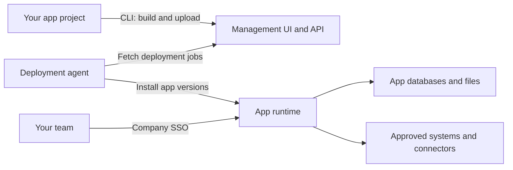

# Show HN: Widefleet – Open-source platform for agent-built apps and workflows

> [!info] 一句话导读
> Platform for agent-built apps and workflows

> [!meta]- 语料信息（点开展开）
> 来源：HN Show HN（post）
> 原帖：<https://news.ycombinator.com/item?id=50022986>
> 指标：点赞=3 · 评论=1 · engagement_velocity=3
> 作者：jonathan_laib　|　发布：2026-10-09T16:33:10Z
> 项目链接：<https://github.com/widefleet/widefleet>
> 采集：2026-10-10T10:11:21+08:00　|　id：`850f4cc47ca6b61d`

## 正文

# widefleet/widefleet

Platform for agent-built apps and workflows

- Stars: 6
- Forks: 0
- Watchers: 6
- Open issues: 0
- License: MIT License
- Homepage: https://widefleet.com
- Default branch: main
- Created: 2026-10-09T11:45:35Z

## Languages

- Astro
- CSS
- Dockerfile
- HTML
- JavaScript
- MDX
- PLpgSQL
- Rust
- Shell
- Svelte
- TypeScript

## Top Contributors

- tnkuehne (9 contributions)
- jonathanlaib (2 contributions)

---

## README

# Widefleet

**Open-source, self-hosted platform for agent-built apps and workflows.**

Build internal tools with your coding agent and keep the app code in your own project. Widefleet gives your team a shared place to deploy and use them, with company login, databases, file storage and controlled access to your systems.

Try it locally · Deploy your first app · Self-host · Documentation

_The management workspace with synthetic example apps._

## What you can do

- **Build with your own tools.** Start with an independent SvelteKit project, edit it with your coding agent and deploy through the CLI.
- **Give colleagues access.** Use company SSO, manage app access groups and make apps discoverable in the shared catalog.
- **Keep app data together.** Declare databases, file storage and key-value bindings. Data survives code deployments; previews have their own resources. Runtime and storage.
- **Control system access.** Grant specific external destinations through network permissions and expose IT-managed services through connectors.
- **Run background work.** Use Cron, Queues and durable Workflows, including retries and waits for events.
- **Operate your apps.** Publish previews, inspect deployment history, roll back code and query app logs from the CLI.

## Try it locally

Use **Linux x86-64**, **Docker Engine 29.8.1**, Docker Compose **2.20.0 or newer**, Bash, Git and an internet connection. Rootless Docker is supported. Keep ports `25450`, `25452` and `25453` available. No local Node.js, pnpm, Rust, company identity provider or DNS setup is needed.

```sh
git clone https://github.com/widefleet/widefleet.git
cd widefleet
./dev up
```

1. Open **http://localhost:25450**, choose **Sign in with Microsoft** and select **admin@example.test** in the local identity provider.
2. Open **Team Notes** from management and sign in with the same account.
3. Add a note and a photo to try the app's database and private file storage.

On the first visit, accept the local self-signed certificate exception for **https://auth.apps.localhost:25453** and **https://team-notes.apps.localhost:25453**. These hosts resolve to your machine; the demo does not install a system certificate.

```sh
./dev down # Stop the demo and keep its data; run ./dev up to resume
```

The demo uses synthetic identities and local-only credentials. See local development for rebuilding the example, inspecting logs and resetting demo data. For a company installation, follow self-hosting.

## Deploy your first app

For an existing Widefleet installation, install the CLI, Node.js 26 and pnpm 12.4.2. Create your app outside the platform checkout:

```sh
widefleet init my-app
cd my-app
pnpm install --frozen-lockfile
pnpm check
export PLATFORM_URL=https://platform.example.com
widefleet login
widefleet deploy
```

Replace `PLATFORM_URL` with your management URL and approve the device code in your browser. `widefleet deploy` builds locally, creates the app on its first deployment and prints its URL after activation. Later deployments update the same app.

Use `pnpm dev` to develop locally with your coding agent. Run `widefleet preview` to publish an isolated preview, then `widefleet deploy` when ready. See the app development guide for identity, data bindings and migrations.

## How it works



Management stores configuration and deployment jobs. The agent installs built code into a shared celld fleet, where apps and previews run as separate Dynamic Workers with their own resources. Published apps keep serving when management or the agent is stopped; the runtime, proxy, identity service and storage must remain available. See the architecture for the full deployment and authentication model.

## Self-hosting and current support

The reference installation runs on one Linux x86-64 Docker host. You operate identity configuration, DNS, certificates, backups and upgrades. Follow the installation guide; use external services for external PostgreSQL, cloud storage and automatic HTTPS.

Widefleet is a platform for trusted company app creators. The included starter uses SvelteKit and the Workers runtime. Node.js compatibility is partial, app cookies are stripped by SSO, and automatic multi-node scaling is not implemented. See runtime limits.

This README describes the current source branch. Published releases can lag behind it; use matching CLI, management and agent builds and check each guide's version requirements. Workflows require a compatible agent and a runtime advertising Workflow support. See releases and runtime updates.

## Documentation

The documentation website is the home for app creators and installation operators. Repository documentation covers contributing to Widefleet itself:

| Task | Guide |
| ------------------------------- | ------------------------------------------------------------------------------------------------------------------------------------------------------------------------------------------------------------------------------------------------------------------- |
| Build and deploy apps | CLI and app development, previews, migrations, Workflows |
| Control access and integrations | App access, network permissions, connectors |
| Install and operate Widefleet | Operations, storage, upgrades and recovery |
| Inspect logs and reporting | App logs, installation reporting and opt-out |
| Understand the platform | Runtime, compatibility, API and uploads |
| Work on this repository | Contributor documentation, development and checks |

## Contributing and support

Use GitHub Issues for bugs, questions and feature requests. Include the relevant version and a minimal reproduction with synthetic data. For code changes, start with development and checks and follow the repository's contributor rules.

## License

All current Widefleet functionality is available under the MIT license,
including the platform, CLI and app starter. Third-party components retain their
own licenses and notices.

## 评论（1/1）

> **tnkuehne** · 2026-10-09T16:34:25.000Z　
> Hi, one of the maintainers here. Happy to answer any questions

## 关联链接

- http://localhost:25450**,
- https://auth.apps.localhost:25453**
- https://github.com/widefleet/widefleet.git
- https://platform.example.com
- https://team-notes.apps.localhost:25453**.
- https://widefleet.com

## 导航

- 项目页：[[10-项目/github.com_be748dee]]
- 渠道页：[[50-渠道/hn_show]]
- 赛道：`AI 工具/Agent`（见 [[浏览]] 的「按赛道」视图）
- 同渠道/同赛道批量浏览：[[浏览]]
