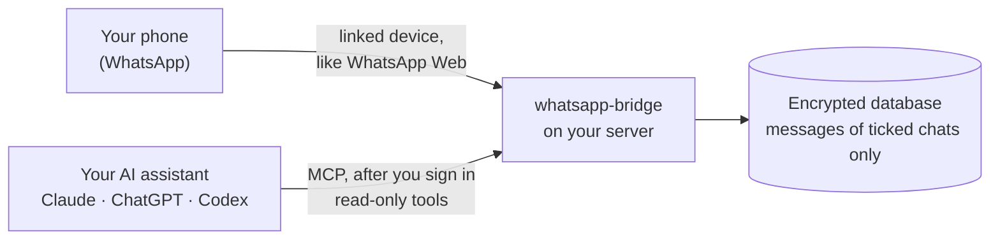

# Show HN: WhatsApp Bridge for those with their own VPS

> [!info] 一句话导读
> vid-t/whatsapp-bridge

> [!meta]- 语料信息（点开展开）
> 来源：HN Show HN（post）
> 原帖：<https://news.ycombinator.com/item?id=50225644>
> 指标：点赞=3 · 评论=3 · engagement_velocity=3
> 作者：vid_t　|　发布：2026-10-24T21:41:02Z
> 项目链接：<https://github.com/vid-t/whatsapp-bridge>
> 采集：2026-10-25T23:24:35+08:00　|　id：`49880bc6f733ab3c`

## 正文

# vid-t/whatsapp-bridge

Self-hosted, read-only bridge to your WhatsApp chats, with an MCP server and a web admin UI built on top of whatsmeow

- Stars: 2
- Forks: 0
- Watchers: 2
- Open issues: 1
- License: GNU Affero General Public License v3.0
- Default branch: main
- Created: 2026-10-24T09:37:35Z

## Languages

- CSS
- Dockerfile
- Go
- HTML
- JavaScript
- Shell
- TypeScript

## Topics

- claude
- golang
- mcp
- mcp-server
- model-context-protocol
- self-hosted
- whatsapp
- whatsmeow

## Top Contributors

- vid-t (12 contributions)

---

## README

# whatsapp-bridge

**A self-hosted bridge & seutp gateaway built on top of whats-meow for storing and accessing your raw whatsapp data**

CI
Licence: AGPL-3.0-only

whatsapp-bridge links to your WhatsApp as an extra device, the way WhatsApp Web does. It keeps
the chats you choose in an encrypted database on your own VPS, where you can serach the chats or query them using MCP. For now, it is read only.

## How it works



1. **Link.** On your phone, open **Settings › Linked devices › Link a device** and scan the
 QR code. The bridge now receives your messages like any other linked device in WhatsApp.
2. **Tick.** Choose only which chats it keeps. Every chat starts unticked, and the bridge
 stores none of its messages until you tick it. Tick within an hour of linking to also
 keep the history WhatsApp sends at linking.
3. **Ask.** Connect your assistant to `https:// /mcp` and sign in. It searches
 and reads your ticked chats when it needs to, and cites every message it uses.

## Try it locally

Go 1.27 or newer. The web UI is built into the binary.

```sh
git clone https://github.com/vid-t/whatsapp-bridge.git && cd whatsapp-bridge
CGO_ENABLED=0 go build -o bin/whatsapp-bridge ./cmd/whatsapp-bridge
./bin/whatsapp-bridge keygen > whatsapp-bridge.env && chmod 600 whatsapp-bridge.env
./bin/whatsapp-bridge serve -env-file whatsapp-bridge.env
```

Open, enter the access code from `whatsapp-bridge.env`, link
WhatsApp and tick your chats. Tick them within the hour to keep their recent history.

> [!IMPORTANT]
> `whatsapp-bridge.env` holds the database key. Without it the database cannot be read, so
> back it up.

## Run it on a server

claude.ai and ChatGPT reach the bridge from their own servers, so they need a public HTTPS
address. Claude Code and Codex also work over `localhost` or a private network.
`deploy/SELF-HOSTING.md` has three paths. Each ends at
`https:// ` with automatic HTTPS from Caddy.

| Path | Best for |
|---|---|
| **A. cloud-init** | a fresh VPS: paste one file and boot |
| **B. Docker Compose** | a server that already runs Docker |
| **C. Install script** | an existing Ubuntu 24.04 or Debian 12 server |

You need a domain pointing at the server, with ports 80 and 443 open.

## Connect your assistant

In Claude Code:

```sh
claude mcp add --transport http whatsapp-bridge https://<host>/mcp
claude mcp login whatsapp-bridge
```

In claude.ai, Claude Desktop, ChatGPT or Codex, add `https:// /mcp` as a connector and
sign in on the page that opens. `docs/MCP-SETUP.md` has the steps for
each assistant, plus API keys for scripts.

Your assistant gets six read-only tools:

| Tool | What it does |
|---|---|
| `search_messages` | full-text search across the ticked chats |
| `read_chat` | read one chat in time order |
| `get_message_context` | show the messages around a search hit |
| `list_chats` | list the ticked chats, most recent first |
| `get_document` | give the file name and caption of an attachment |
| `get_status` | show the linked devices and how fresh the data is |

Every message comes with a `wa://` citation, so you can check the source of an answer.

## Privacy and safety

- **Read-only.** The code has no way to send messages, an "online" status or read receipts.
 The tools cannot change or delete anything.
- **Only ticked chats.** Chats start unticked. The bridge never stores the messages of an
 unticked chat, only its name and last activity for the chat list, so no assistant can see
 it. For an hour after you link a phone, it holds those messages in memory only, so a chat
 you tick in that hour keeps its history. Then they are dropped.
- **Encrypted at rest.** The database file is encrypted with Adiantum when `BRIDGE_DB_KEY`
 is set (`keygen` creates it). A running bridge decrypts messages in memory, so run it on
 a machine you control.
- **Closed by default.** It listens on `127.0.0.1` and refuses a public address unless an
 access code and a database key are set.
- **Audited.** Every tool call is logged: who called it, which tool, which chats and how
 many rows. The log never holds message text.
- **Nothing goes to an AI provider on its own.** Your assistant gets messages only when it
 calls a tool, and only that call's results.
- **Your phone stays in charge.** Unlink the device in WhatsApp and the bridge is cut off
 at once. WhatsApp also logs out linked devices when the phone has been offline for 14
 days.

> [!WARNING]
> **Unofficial client.** whatsapp-bridge uses whatsmeow,
> an unofficial implementation of the WhatsApp Web protocol. It is not affiliated with,
> endorsed by or connected to WhatsApp or Meta. WhatsApp does not permit unofficial
> clients, and an account linked to one can be restricted. Staying silent and read-only
> keeps that risk low but cannot remove it. You accept it when you link an account.

**Not built yet:** downloading attachments and reading their text, and limiting what each
member sees (today every member sees all ticked chats).

## Documentation

- Configuration and commands: every setting, flag and command
- Self-hosting: install, upgrade and back up
- Connect your assistant: Claude, ChatGPT, Codex and API keys
- Security policy · Contributing

## Licence

AGPL-3.0-only. If you run a modified whatsapp-bridge as a service, you must offer
its source code to the people who use it.

Error fetching https://chatgpt.com/plugins/plugin_asdk_app_6abdec89d46c81919cda058ca9f62cb8?search=call4me: CRAWL_EMPTY_CONTENT

## 评论（3/3）

> **vid_t** · 2026-10-24T21:41:02.000Z　
> Hi for anyone that uses their own VPS and wants to either keep a history of their whatsapp or use your chats and attachements via MCP, I'd be curious what you think about https://github.com/vid-t/whatsapp-bridge.It's build on whatsmeow the bridge for whatsapp and stores your chats in an encrypted database you own and can connect with MCP so your agents can query the chats, plus has a basic UI to link your whatsapp and chose which chats you want stored.This is read only only for now but I would be glad if someone wants to contribute the sending option or streamline the deployment. Thanks for the feedback in advance.

---

> **kinduff** · 2026-10-24T23:28:45.000Z　
> Looks good so far. I maintain a SaaS that hosts this for you, the amount of lessons I've learned to scale this up were very fun and others frustrating.I also use whatsmeow but had to add some layers for tenant isolation and resource manangement. I was able to come up with an image as little as 30mb and full control over the resources - uses as little as 60mb of RAM.

---

> **vid_t** · 2026-10-25T09:08:11.000Z　
> Nice! Did you run this as a hosted service for companies that wanted full access to their WhatsApp? I just wonder how you made it work with trust? Was it fully closed sourced, on your servers?I could imagine that users would want to see how and where the data is stored.

## 关联链接

- https://chatgpt.com/plugins/plugin_asdk_app_6abdec89d46c81919cda058ca9f62cb8?search=call4me:
- https://github.com/vid-t/whatsapp-bridge.git

## 导航

- 项目页：[[10-项目/github.com_f401edcf]]
- 渠道页：[[50-渠道/hn_show]]
- 赛道：`AI 工具/Agent`（见 [[浏览]] 的「按赛道」视图）
- 同渠道/同赛道批量浏览：[[浏览]]
