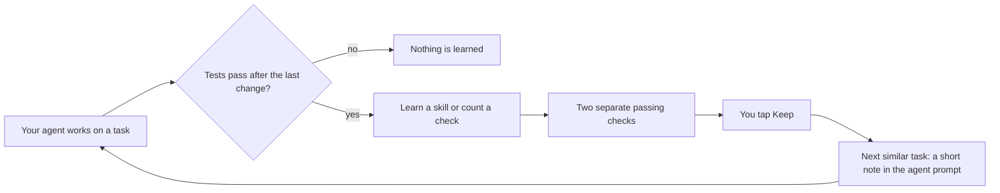

# Show HN: MuscleMemory – procedural memory for coding agents, proven by tests

> [!info] 一句话导读
> TheWariend/MuscleMemory

> [!meta]- 语料信息（点开展开）
> 来源：HN Show HN（post）
> 原帖：<https://news.ycombinator.com/item?id=50235670>
> 指标：点赞=5 · 评论=0 · engagement_velocity=5
> 作者：maaaz　|　发布：2026-10-25T20:19:47Z
> 项目链接：<https://github.com/TheWariend/MuscleMemory>
> 采集：2026-10-26T09:42:36+08:00　|　id：`554c656578e49332`

## 正文

# TheWariend/MuscleMemory

Open-source procedural memory for AI agents. Learns from what worked and what failed.

- Stars: 8
- Forks: 1
- Watchers: 8
- Open issues: 1
- License: Apache License 2.0
- Homepage: https://thewariend.com/musclememory
- Default branch: main
- Created: 2026-07-21T03:37:58Z

## Languages

- CSS
- Dockerfile
- HTML
- JavaScript
- Mako
- Python
- TypeScript

## Topics

- agent-memory
- ai-agents
- claude-code
- cleanslate
- codex
- coding-agents
- mcp
- procedural-memory

## Top Contributors

- maaz7n (27 contributions)

---

## README

 MuscleMemory

 Open-source procedural memory for AI agents.
 It learns from what worked and what failed.
 Local by default · Apache-2.0 · by TheWariend

---

Coding agents relearn the same things every session: which files to open, how the tests
run, what broke last time. MuscleMemory watches your agent work. When a task really
succeeds (the tests pass after the last change), it learns how the task was done. The next
time a similar task comes up, it hands the agent a short note: the files to change, the
test that proves it worked, and what to avoid.

In a benchmark with real Codex sessions, it cut **input tokens by 25.5%, tool calls by 30.4%
and time by 28.2%**, with every task still passing. In an early run with Claude Code and
Sonnet 5.5, using skills that Codex had learned, it cut **input tokens by 43.5% and tool
calls by 30%**. On real Django issues from SWE-bench, with a skill learned from other
issues in the same area, Codex solved as many as without memory with about half the tokens
(a small run; details).
Check them yourself: `python benchmarks/reproduce.py check`.
Codex method and data ·
Claude Code run ·
Whitepaper.

## Quick start

```sh
pipx install thewariend-musclememory  # or, from a clone: pip install -e .

musclememory init                      # sets up ~/.musclememory and the small search model
musclememory start                     # runs in the background on http://127.0.0.1:8080
cd your-project && musclememory connect codex   # or claude, cursor, cleanslate
musclememory dashboard                 # opens the dashboard, already signed in
```

Then use your agent as usual. There are no keys or config files to copy.

Or let your agent set it up: paste this into Claude Code, Codex or Cursor.

```text
Read https://thewariend.com/musclememory/llms.txt and set up MuscleMemory for this project.
```

More in Install.

## How it works



- **Verified, twice.** A skill is trusted only after two separate sessions pass with it.
 The session it was learned from doesn't count. One failed check pauses it.
- **Learns from failures.** Failed attempts become plain "watch out" and "if it goes wrong"
 notes, so the agent avoids the same dead ends.
- **You stay in charge.** Automatically learned skills wait for your OK before any agent
 sees them. Agents still read the current files and ask for approval as usual.
 MuscleMemory never replays actions.
- **Quiet when it should be.** If nothing fits, nothing is added, and the agent pays no
 extra tokens.
- **Shared between agents.** A skill learned with Codex is handed to Claude Code or
 Cursor too: changing a file counts the same whichever tool did it.
 Proven skills can also be exported to Codex or Claude Code as `SKILL.md`.
- **Local and open.** SQLite and a small on-device model by default: no account and no
 outside calls. Use PostgreSQL with pgvector for teams.

More detail in How it works.

## Works with

| Agent | How it connects |
|---|---|
| Claude Code | `musclememory connect claude` installs capture hooks |
| Codex | `musclememory connect codex` installs capture hooks |
| Cursor | `musclememory connect cursor` installs capture hooks |
| CleanSlate | `musclememory connect cleanslate` wires its host stream |
| Any MCP client | Five tools: recall, observe, learn, evaluate, inspect |
| Your own agent | Python and TypeScript SDKs |

See Integrations.

## Dashboard

| | |
|---|---|
| Home | Skills |
| **Home:** what your agents can reuse, and anything waiting for your OK | **Skills:** each one with the task it came from, the files it changes and the test that checks it |
| A skill | Connect |
| **A skill:** its steps in plain words, its proof, and what to watch out for | **Connect:** one command per agent |

## Docs

- Whitepaper: the design, trust rules, retrieval and evaluation in one paper
- Install and run: local setup, Docker and PostgreSQL, configuration
- How it works: the learning loop, retrieval, storage and security
- Integrations: each agent, MCP and the SDKs
- Benchmarks: results, method and limits
- API contracts: MCP tools and REST
- Roadmap: what's next and known limits

## Status

MuscleMemory works and is tested: 126 Python tests on SQLite and PostgreSQL, and 21
TypeScript tests. It's early. The benchmarks cover repeat tasks on three controlled codebases,
not every kind of work, and the Claude Code run is small. The hooks and CleanSlate learn on their own; with the SDKs your code
reports when a task succeeded.
See the roadmap.

Issues and pull requests are welcome. Please report security issues privately, as
described in SECURITY.md.

## License

Apache-2.0. Made by TheWariend.

# SecuBuzz · Quick Cybersecurity News in 60 Words & CISA KEV Radar

## 关联链接

- http://127.0.0.1:8080
- https://thewariend.com/musclememory
- https://thewariend.com/musclememory/llms.txt

## 导航

- 项目页：[[10-项目/github.com_3bd55a0d]]
- 渠道页：[[50-渠道/hn_show]]
- 赛道：`AI 工具/Agent`（见 [[浏览]] 的「按赛道」视图）
- 同渠道/同赛道批量浏览：[[浏览]]
