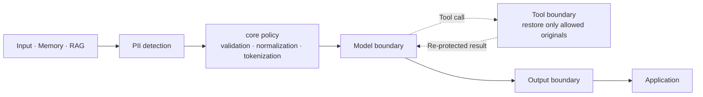

# Show HN: Spring AI Privacy Guardrails – PII, tool permissions, content checks

> [!info] 一句话导读
> ultramancode/spring-ai-privacy-guardrails

> [!meta]- 语料信息（点开展开）
> 来源：HN Show HN（post）
> 原帖：<https://news.ycombinator.com/item?id=50259632>
> 指标：点赞=2 · 评论=0 · engagement_velocity=2
> 作者：ultramancode　|　发布：2026-10-27T14:08:30Z
> 项目链接：<https://github.com/ultramancode/spring-ai-privacy-guardrails>
> 采集：2026-10-27T23:46:32+08:00　|　id：`4f535f2cd2cb4737`

## 正文

# ultramancode/spring-ai-privacy-guardrails

Privacy guardrails for Spring AI: request-scoped PII tokenization and least-privilege disclosure across model/tool calls, with Presidio and JVM-local OpenNLP.

- Stars: 14
- Forks: 0
- Watchers: 14
- Open issues: 1
- License: Apache License 2.0
- Homepage: https://ultramancode.github.io/spring-ai-privacy-guardrails/
- Default branch: main
- Created: 2026-08-05T05:52:39Z

## Languages

- Java
- Shell

## Topics

- ai-guardrails
- artificial-intelligence
- data-privacy
- generative-ai
- guardrails
- java
- llm
- mcp
- model-context-protocol
- nlp
- opennlp
- pii
- pii-detection
- pii-tokenization
- presidio
- privacy
- spring-ai
- spring-boot
- spring-boot-starter
- tool-calling

## Top Contributors

- ultramancode (31 contributions)

---

## README

# Spring AI Privacy Guardrails

Maven Central
CI
License

English | 한국어 | Documentation

 Watch the demo:
 English ·
 한국어

**Detect PII with built-in and pluggable analyzers. Control where original
values may travel.**

When protection is applied to a `ChatClient`, PII detected by analyzers is
replaced with request-scoped tokens before the input is sent to the model.
Immediately before a protected tool runs, original values are restored only for
the entity types allowed by policy, and the tool result is protected again.
Final-response inspection can be enabled when needed.

Spring AI Privacy Guardrails combines a Spring-independent privacy `core` with
Spring AI integration to enforce privacy policies across chat, RAG, memory,
tool-call, and output boundaries.

## Why It Exists

Detection is the first step. This library turns findings from built-in and
pluggable analyzers into request-scoped policy at the model, tool, and output
boundaries.



## Run the Sample

The sample includes a deterministic local `ChatModel`, so no cloud credentials
are required. With JDK 17 installed, run the following command from the
repository root:

```bash
./gradlew :spring-ai-privacy-guardrails-sample-demo:run
```

Open `http://127.0.0.1:8080` to use the sample's **Privacy Boundary
Inspector**. Its views render runtime evidence returned by the sample backend:

- **Local Tool** shows detected raw values replaced with opaque request-scoped
 tokens at the model boundary, only the allowed `CUSTOMER_ID` restored at the
 tool boundary, and the tool result protected again before model re-entry.
- **RAG** compares the raw retrieved document with the protected context
 actually recorded at the model boundary.
- **MCP** demonstrates the same scoped disclosure and result re-protection
 through a real local Streamable HTTP MCP round trip.

Text not matched by the demo's detection rules may be returned unchanged by the
local model, and the Inspector does not expose token mappings. The
Sample Guide covers the Local Tool, RAG, and
runtime MCP demos plus optional Presidio, OpenNLP, and real-model integration.

The default repository checks do not call remote models. See the
Privacy Boundary Verification Matrix
for the corresponding reproducible automated coverage.

## Add Protection to an Application

For a step-by-step setup path, see Getting Started.

The following example adds privacy boundaries to a Spring AI application that
already provides a `ChatModel` and `ChatClient.Builder`.

### Choose a Starter

Choose the starter that matches the analyzer you plan to use.

| Use case | Starter |
| --- | --- |
| Broader PII detection | `spring-ai-privacy-guardrails-presidio-spring-boot-starter` (recommended) |
| Regex rules or custom analyzers | `spring-ai-privacy-guardrails-spring-boot-starter` |
| JVM-only environment with compatible OpenNLP models | `spring-ai-privacy-guardrails-opennlp-spring-boot-starter` |

For broader PII detection, Presidio is the recommended default choice. Use the
built-in Regex analyzer for application-specific formats.

The Presidio starter requires an external Presidio Analyzer service. The
Presidio and OpenNLP starters already include the base Privacy Guardrails
starter, so do not add it separately. Adding a starter dependency alone enables
neither privacy protection nor an analyzer.

### Dependency and Basic Configuration

The examples below use version `0.2.0`. To start without an external analyzer
service, use the base starter with an application-specific regex rule.

```gradle
dependencies {
    implementation "io.github.ultramancode:spring-ai-privacy-guardrails-spring-boot-starter:0.2.0"
}
```

```yaml
spring:
  ai:
    privacy:
      enabled: true
      output:
        enabled: true
        action: tokenize
      regex:
        enabled: true
        rules:
          - entity-type: EMPLOYEE_ID
            pattern: "(?<![A-Za-z0-9_])EMP-[0-9]{4}(?![A-Za-z0-9_])"
            score: 0.90
```

The `output` section is optional. When omitted, final-response inspection is
disabled.

This example rule is application-specific and detects only values in the
`EMP-1234` format. It does not establish general PII-detection performance.
Validate analyzers for production using data representative of your
environment.

### Protect a ChatClient

Apply the starter-provided configuration to each `ChatClient.Builder` that you
want to protect.

```java
@Bean
ChatClient privacyChatClient(
        ChatClient.Builder builder,
        PrivacyChatClientConfigurer privacyConfigurer
) {
    return privacyConfigurer.configure(builder).build();
}
```

Only `ChatClient` instances configured with `PrivacyChatClientConfigurer` are
protected. Enabling privacy protection requires at least one analyzer;
otherwise, application startup fails.

Direct calls to a `ChatModel` are outside the automatic protection boundary.
See Configuration for derived clients, analyzer
combinations, and failure policies.

## Per-Tool Original Disclosure

Registering a tool does not grant access to original PII values. Disclosure is
deny-by-default. Original values are restored immediately before execution only
when the policy lists both the exact, case-sensitive tool name and the required
canonical entity types.

```yaml
spring:
  ai:
    privacy:
      tools:
        disclosures:
          customerLookup:
            - CUSTOMER_ID
```

Wrap an existing Spring AI `ToolCallback` with `PrivacyToolCallbackFactory` and
register the wrapped callback with a protected `ChatClient`.

```java
ToolCallback protectedCustomerLookup =
        toolCallbackFactory.wrap(customerLookupToolCallback);
```

Here, `customerLookupToolCallback` is the application's existing Spring AI
`ToolCallback`.

In the standard tool-execution path of a protected `ChatClient`, unwrapped
callbacks are rejected before execution. Tool results are protected again
before they are returned to the model or application.

For a `ToolCallbackProvider` whose tool list changes at runtime, such as an MCP
provider, use `wrapProvider(...)`. Combine multiple `ToolCallbackProvider`
instances with `wrapProviders(...)`.

The application must protect any separate execution paths that use a custom
`ToolCallingManager` or
`ToolCallbackResolver`. See
Per-Tool Original Disclosure
for the complete rules.

## Core Protection Behavior

- Each protected request uses an isolated `PrivacySession`. Detected PII in
 supported model input, including memory and RAG content, is tokenized before
 the model call.
- Protected tools receive only original values allowed by policy. Structured
 tool input remains least-privilege, and tool results are protected again
 before they reach the model or application, including `returnDirect`.
- When enabled, output protection applies `TOKENIZE`, `REDACT`, or `BLOCK` to
 completed responses. Streaming responses are buffered for inspection, and
 managed session mappings are cleared on completion, failure, or cancellation.

See Configuration for detailed behavior and
Architecture for request flow and module
responsibilities.

## Privacy-Safe Runtime Observation

Applications can optionally register a `PrivacyEnforcementObserver` to receive
privacy enforcement events at supported model, tool-input, tool-result, and
application-output boundaries. Each event contains only `boundary`, identifying
where it occurred, and `outcome`, describing the result at that boundary. It does
not include PII, tokens, payloads, tool names, or request identifiers.

See Privacy-Safe Runtime Observation
for registration, outcome semantics, and callback execution guidance.

## Published Modules

Analyzer-specific starters bring in their runtime modules as transitive
dependencies. Add test support separately in the application's test scope.

| Module | Purpose |
| --- | --- |
| `spring-ai-privacy-guardrails-core` | Analyzer SPI, detection resolution, sessions, regex analysis, and tokenization |
| `spring-ai-privacy-guardrails-spring-ai` | Advisors and per-tool original-disclosure boundaries |
| `spring-ai-privacy-guardrails-presidio` | Presidio Analyzer HTTP adapter |
| `spring-ai-privacy-guardrails-opennlp` | JVM-only adapter for user-supplied OpenNLP models |
| `spring-ai-privacy-guardrails-test` | Optional model and tool probes with AssertJ assertions |

See Architecture for module responsibilities and the
dependency structure. The repository-only JMH benchmark module is not
published as a library. Its workloads and execution instructions are described
in Evaluation.

## Compatibility and Status

| Component | Verified version |
| --- | --- |
| Java baseline | 17 |
| Java compatibility CI | 17, 21, 25 |
| Spring AI | 2.0.0 |
| Spring Boot | 4.1.0 |
| Gradle wrapper | 9.6.1 |

CI runs the default verification on Java 17, 21, and 25. On Java 21, it
separately runs live integration tests against a Presidio service and the JMH
smoke tests.

## Documentation

- Getting Started: step-by-step starter selection and
 privacy-boundary setup
- Configuration: starters, analyzers, tool policies,
 and output policies
- Architecture: modules and model, tool, and session
 execution flow
- Threat Model: protected assets, trust boundaries,
 controls, limitations, and separately managed areas
- Evaluation and Benchmarks: verification coverage and
 interpretation limits
- Sample / Demo Guide: Inspector scenarios, runtime endpoints,
 and the evidence each view verifies
- Full Sample Guide: optional analyzer and
 real-model integration examples

## Security Boundary

This library reduces the risk of accidental PII disclosure on supported Spring
AI execution paths, but it is not a complete DLP system or a guarantee of legal
compliance.

Applications remain responsible for:

- authentication, authorization, and logging policies;
- access control and data-retention policies for stored `ChatMemory`, vector
 stores, and databases;
- validating and tuning analyzer quality for the production environment;
- protecting response metadata and non-text media outside the explicitly
 supported reasoning text; and
- authentication and transport encryption for remote analyzers.

Before using the library in production, review Security and the
Threat Model.

## Build and Verify

```bash
./gradlew --no-daemon clean check
```

This command runs the repository's tests and verifies its modules and
documentation. See Evaluation for the demo analyzer
regression test and JMH benchmarks.

## Contributing

See Contributing. All contributions are provided under the
Apache License 2.0.

# cordane/cordane

## 关联链接

- http://127.0.0.1:8080`
- https://ultramancode.github.io/spring-ai-privacy-guardrails/

## 导航

- 项目页：[[10-项目/github.com_a2989aa6]]
- 渠道页：[[50-渠道/hn_show]]
- 赛道：`AI 工具/Agent`（见 [[浏览]] 的「按赛道」视图）
- 同渠道/同赛道批量浏览：[[浏览]]
