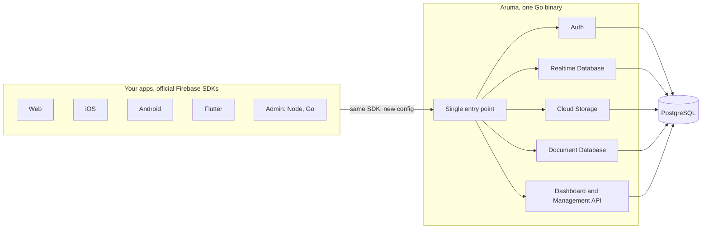

# Show HN: Aruma – clean-room self-hosted backend for the official Firebase SDKs

> [!info] 一句话导读
> Self-hosted backend compatible with the official Firebase SDKs. One Go binary and PostgreSQL.

> [!meta]- 语料信息（点开展开）
> 来源：HN Show HN（post）
> 原帖：<https://news.ycombinator.com/item?id=50319323>
> 指标：点赞=3 · 评论=1 · engagement_velocity=3
> 作者：osama200　|　发布：2026-10-31T19:35:14Z
> 项目链接：<https://github.com/arumadev/aruma>
> 采集：2026-11-01T09:38:09+08:00　|　id：`cb847c9cfb72a9cf`

## 正文

# arumadev/aruma

Self-hosted backend compatible with the official Firebase SDKs. One Go binary and PostgreSQL.

- Stars: 5
- Forks: 0
- Watchers: 5
- Open issues: 0
- License: Apache License 2.0
- Homepage: https://arumadev.github.io/aruma/
- Default branch: main
- Created: 2026-10-17T20:43:27Z

## Languages

- Astro
- CSS
- Dart
- Dockerfile
- Go
- HTML
- Java
- JavaScript
- Makefile
- Objective-C
- PLpgSQL
- Python
- Ruby
- Shell
- Svelte
- Swift
- TypeScript

## Topics

- authentication
- backend-as-a-service
- firebase
- firebase-alternative
- golang
- open-source
- postgresql
- realtime-database
- self-hosted

## Top Contributors

- osama300 (1074 contributions)

---

## README

**A self-hosted backend that speaks the official Firebase SDKs.**
One Go binary and PostgreSQL. Your apps keep the official SDKs; a few platforms need a small helper (see SDK packages).

License
Go
PostgreSQL
Status

Quick start · Status · Docs · SDK packages · Contributing

## What Aruma is

Aruma is a self-hosted replacement for Firebase. It is one Go binary with PostgreSQL and an embedded Next.js dashboard. It serves Firebase Auth, Realtime Database, Cloud Storage, Security Rules and the Document Database (Firestore-compatible) to the official Firebase SDKs, so for Auth, Realtime Database and Firestore on supported setups you change a config file and not your application code. Storage on iOS uses a patched build of the Storage SDK, Flutter Storage needs one helper call (`fromArumaUrl`), and servers that verify ID tokens use Aruma's admin libraries. See SDK packages.

It is for developers and teams who use Firebase and want to run the backend themselves, on a small VPS or on their own servers, with their data in a PostgreSQL they control.

Behavior is checked against real Firebase and the official emulators, and the official Firebase test suites run against Aruma. Differences we know of are documented in known differences.

## Status

Aruma is pre-1.0. The latest release is v0.4.0. Part of the Document Database's verification has not run yet; the changelog lists it.

| Service | Status | Details |
|---|---|---|
| Platform: projects, apps, API keys, service accounts, dashboard, Management API | Released | Architecture |
| Authentication | Released in v0.1.0 | Compatibility, web guide, Admin guide |
| Realtime Database | Released in v0.2.0, off by default (`ARUMA_RTDB_ENABLED`) | Compatibility, guide |
| Security Rules | Released in v0.3.0 | Compatibility, guide |
| Cloud Storage | Released in v0.3.0, off by default (`ARUMA_STORAGE_ENABLED`) | Compatibility, guide |
| Document Database (Firestore-compatible) | Released in v0.4.0, off by default (`ARUMA_DOCUMENTS_ENABLED`); official mobile suites not run yet | Compatibility, guide, migration guide |
| Cloud Messaging, App Check, Remote Config, Functions | Planned | |

## Quick start

With Docker (Aruma and PostgreSQL 18, nothing else to install):

```bash
git clone --branch v0.4.0 https://github.com/arumadev/aruma.git && cd aruma
printf 'ARUMA_MASTER_KEY=%s\nPOSTGRES_PASSWORD=%s\n' "$(openssl rand -base64 32)" "$(openssl rand -hex 24)" > .env
docker compose up -d
docker compose logs aruma | grep code    # the one-time setup code
```

Open, enter the setup code to create your first account, then create a project and an app and copy the config file. Keep `.env`: every key Aruma uses is derived from `ARUMA_MASTER_KEY`.

Without Docker, download the archive for your system from Releases (Linux, macOS and Windows, amd64 and arm64) and point it at your PostgreSQL 18, or build from source with Go 1.27.3 and Node 24 (`make dashboard && make dev`).

Getting started goes on from here: the three ways to install, running on a server, creating a project and an app, and signing a user in from a web app. Settings are in configuration.

## How apps connect

Your app keeps the official SDK and takes the config file from Aruma. Where a platform has Google's hosts compiled in, a small package under `sdk/` points the SDK at your server with one line of build or manifest configuration. The packages and what each one does are in SDK packages.



Every project's data is reached through its project number, directly or through a project-scoped parent such as a Realtime Database id. A CI test fails any SQL query on a project table that neither filters by project nor carries a reviewed scope annotation. Aruma does not use PostgreSQL row-level security. See architecture.

**Cloud Functions.** Aruma does not serve Cloud Functions. If an app signs in with Aruma Auth and calls a function with `httpsCallable`, the SDK sends the user's Aruma ID token to Google. Do not use callable functions in such an app. See known differences.

## The dashboard

Every Aruma server ships with a dashboard, embedded in the same binary. Create projects and apps, manage users, edit rules, browse data and files, and download the config files your apps need.

## Documentation

- Getting started
- Documentation index
- Guides: web Auth, Admin Auth, Realtime Database, Cloud Storage, security rules, Firestore, Firestore migration, mobile apps, operations
- Reference: configuration, compatibility, known differences, console API
- Architecture, security, testing, benchmarks
- Changelog

To report a vulnerability, read SECURITY.md.

## Contributing

Issues and pull requests are welcome. Start with CONTRIBUTING.md.

## License

Apache License 2.0, see LICENSE and NOTICE. Firebase is a trademark of Google LLC. Aruma is not affiliated with Google and is not endorsed by it.

Error fetching https://github.com/vahokif/I26: CRAWL_LIVECRAWL_TIMEOUT

## 评论（1/1）

> **osama200** · 2026-10-31T19:35:14.000Z　
> Hi HN,I built a clean-room Google Firebase alternative that keeps the official SDKs and cuts your bill to a ~$5 VPS: unlimited projects, no per-operation pricing.Aruma is an open-source backend you host yourself. It speaks the same protocols as Firebase, so your app keeps the official Firebase SDKs (JS, Android, iOS, Flutter, Admin); you just point them at your own server instead of Google's. The SDKs run in normal production mode, not emulator mode.What works today:- Authentication- Realtime Database- Cloud Storage- Cloud FirestoreIt ships as a single Go binary on PostgreSQL, and you own your data.Clean-room: Firebase's backend is closed source, so Aruma was built from public documentation and the observed behavior of the SDKs against real Firebase and the emulators. No Google server code.Status: early, not production-ready yet. I'm working toward a stable release and an automatic tool to migrate data off Firebase. Next: push notifications and App Check, then Remote Config and Functions.Feedback I want most: SDK compatibility gaps. If your app breaks against Aruma, please open an issue.Repo: https://github.com/arumadev/aruma
> Docs: https://arumadev.github.io/aruma

## 关联链接

- https://arumadev.github.io/aruma/
- https://github.com/arumadev/aruma.git
- https://github.com/vahokif/I26:

## 导航

- 项目页：[[10-项目/github.com_e0869345]]
- 渠道页：[[50-渠道/hn_show]]
- 赛道：`AI 工具/Agent`（见 [[浏览]] 的「按赛道」视图）
- 同渠道/同赛道批量浏览：[[浏览]]
