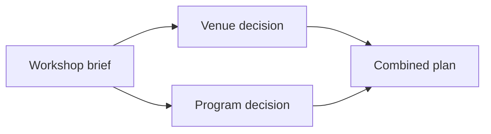

# Show HN: Nouli – A decision model TUI to branch and blend multiple histories

> [!info] 一句话导读
> A ledger-backed decision network that records AI decisions and connects them to the facts and earlier answers they use.

> [!meta]- 语料信息（点开展开）
> 来源：HN Show HN（post）
> 原帖：<https://news.ycombinator.com/item?id=50329343>
> 指标：点赞=3 · 评论=0 · engagement_velocity=3
> 作者：SurfingAlpaca　|　发布：2026-11-01T20:18:54Z
> 项目链接：<https://github.com/nouli-ai/nouli>
> 采集：2026-11-02T09:37:22+08:00　|　id：`dafc78c0fb90d3cd`

## 正文

# nouli-ai/nouli

A ledger-backed decision network that records AI decisions and connects them to the facts and earlier answers they use.

- Stars: 7
- Forks: 0
- Watchers: 7
- Open issues: 0
- License: MIT License
- Homepage: https://nouli.ai
- Default branch: main
- Created: 2026-10-26T22:24:57Z

## Languages

- CSS
- HTML
- JavaScript
- Python
- Rust
- Shell

## Topics

- decision-graph
- decision-models
- decision-network
- fine-tuning
- harness
- harness-ai
- jev
- jev-ai
- jev-api
- jev-model
- laya
- multi-turn
- openai-decisions-api
- rust
- rust-cli
- rust-crate
- tui-app

## Top Contributors

- aravind-n (124 contributions)

---

## README

# Nouli

**Every decision has a history.**

Keep the facts behind a decision, add what changes, and ask the next question without losing the earlier answer. Nouli is a terminal app, CLI, and Rust library for connected decision histories: a ledger-backed decision network. Use a compatible decision service, or follow a task-specific model’s local recipe. Use the CLI to run individual model requests with a recorded decision history.

CI Release Total downloads across all release assets License: MIT Rust 1.99.1+

Website · Models · Quickstart · Examples · User guide

## See Nouli in action

Nouli TUI replay: saved decisions, branches, and blends.

*Current terminal app, replaying saved workshop answers at 3× speed. Watch the video or inspect the recording.*

## Quickstart

Install the CLI on Apple silicon macOS:

```sh
brew install nouli-ai/tap/nouli
```

On GNU/Linux, or Apple silicon macOS without Homebrew:

```sh
curl -fsSL https://nouli.ai/install.sh | sh
export PATH="$HOME/.local/bin:$PATH"
```

Then choose a starting path:

- **Run a Nouli model locally:** choose a task-specific model and follow its model card to set up the environment, load weights, start the local service, and run the supplied CLI workflow.
- **Ask broader decision questions:** connect an appropriate general-purpose decision service, choose a model, then open the terminal app:

```sh
nouli connect
nouli
```

In the app, add facts in **Context** and write a plain question in **Question**. **Enter** adds a nonempty context row; Enter on a blank row moves to the next section. **Shift-Tab** changes the answer type and **Tab** moves between sections. Send with **Enter** on a nonempty Question or **Ctrl-S** from any section. Options/Levels use one item per row; blank Enter finishes the list without sending. Use `/exit` to return to your shell. Terminal guide.

A service must support System One or OpenAI Decisions. Provider fees may apply to remote inference. Connection setup.

Prebuilt CLI binaries support Apple silicon macOS and ARM64/x86_64 GNU/Linux with glibc 2.38+. The download installer checks its checksum and installs into `~/.local/bin` by default. Each local model has its own runtime requirements. Installation and upgrades.

## Work in the terminal

- **Choose a model without losing your draft.** Open `/model` or press **Ctrl-L** to search your connections, add one, or enter a missing API key. The selected model stays available in later views.
- **Reuse saved answers and files.** Type `@` to search local history or attach a file. Review its snapshot before sending; references connect the saved source to the new decision.
- **Copy and resize.** Drag normally to select text and use terminal Copy. **Ctrl-P** holds the view while a request continues; Esc resumes. For panel resizing, press **Ctrl-G**, drag the divider, then press **Esc** to return to the form and native selection.
- **Choose what the status line shows.** Use `/statusline` for the Minimal, Session, Request, or Hidden preset, or select individual fields. Preferences are saved beside the connection configuration.

## Models from Nouli

We also publish five task-specific decision models in the nouli-ai Hugging Face organization. Each includes weights, a local serving recipe, and a Nouli CLI workflow.

| Model | What it does |
| --- | --- |
| Nouli Route | English banking intent classification across 77 BANKING77 labels. |
| Nouli Clause | NDA evidence retrieval and a fixed 17-hypothesis checklist. |
| Nouli Push | XY actions from keypoints and history in the PushT simulator. |
| Nouli Doom | Structured-state actions for ViZDoom Deadly Corridor. |
| Nouli Guard | English hate-speech classification: no, unclear, or yes. |

To try one, follow its model card’s **Quickstart with Nouli CLI**: prepare the documented input, start its local server, and run its supplied workflow. The recipes use Python 3.12 and the Hugging Face CLI and do not need a hosted inference API key. Installing Nouli alone does not download or load these models.

These models use task-specific inputs and answer schemas. Their cards include evaluation details, supported runtimes, and limits. Model distributions are **Apache-2.0** with upstream notices; the CLI and Rust library are **MIT**.

## Add one fact. Make the next decision.

After setup, use an appropriate general-purpose decision service and a fresh session name. The five specialized local models use their own supplied workflows. Try this from your shell:

```sh
nouli new trip \
  'The train costs 40 USD. A taxi costs 70 USD. Both arrive on time. Prefer the cheaper option.' \
  -q 'travel: How should I get to the meeting? [Take the train, Take a taxi]'

nouli add trip 'The train has been cancelled.' \
  -q 'travel: How should I get to the meeting? [Take the train, Take a taxi]'

nouli view trip
```

The second command adds only the new fact and asks the question again. Nouli saves a new decision and preserves the first answer. Results depend on the configured model.

Run `nouli context trip` to inspect the context sent for the latest turn. See the recorded meeting example for a three-turn walkthrough.

## Continue, branch, blend, inspect

| When you need to… | Use Nouli to… |
| --- | --- |
| Decide again after new evidence | **Continue** a saved session with what changed. |
| Explore an alternative | **Branch** from the same starting point and keep both paths. |
| Bring separate work together | **Blend** source histories into a new session. |
| Understand a saved decision’s inputs | **Inspect** its facts, actual model context, and session ancestry. |

With an appropriate decision service configured (setup), start with a workshop brief, branch into venue and program decisions, then blend their histories into a plan:



 Run the branch-and-blend example

```sh
nouli new workshop \
  'Plan a step-free workshop for 60 people. Budget: 6000 USD.' \
  -q 'feasible: Can we plan this workshop?'

nouli new venue --from workshop \
  'Riverside Hall is step-free, fits 80 and costs 1200 USD. The Loft costs 900 USD but has stairs.' \
  -q 'venue: Which venue should we choose? [Riverside Hall, The Loft]'

nouli new program --from workshop \
  'Two speakers are available. Include breaks and useful hands-on time. The program costs 500 USD.' \
  -q 'program: Which program should we run? [Talks and practice, Talks only]'

nouli new plan --from venue --from program \
  'The venue and speakers can confirm today. Total event costs are 3500 USD, including lunch, materials and transport.' \
  -q 'confirm: Should we confirm the plan? [Confirm the plan, Revise the plan]'

nouli view plan
```

These commands create the session structure above. Each model call saves its own answer; the diagram shows ancestry, not predicted results.

A branch or blend captures its sources at creation. Later source updates do not silently change it. In the terminal app, `@` also lets you reuse an exact saved answer from another session. Branching and blending.

## Use the same history from scripts and agents

After the trip example, read its saved decisions and context as JSON:

```sh
nouli sessions export trip --format json
nouli context trip --json
```

Any coding agent that can run shell commands can use the CLI. Start it with the agent reference. Use request files for structured input and workflows for dependent decisions, or embed the Rust library in your application.
The Hugging Face releases also include task-specific workflow files and local System One server adapters. Use each model’s documented input schema when running those workflows.

## Examples with recorded answers

- Meeting travel: continue as circumstances change.
- Robotic picking: combine item history with station rules.
- Product recall: combine three source sessions through two layers of blends. Inspect the recorded graph.
- More walkthroughs: investing, lending, credit limits, vulnerability response, and energy planning.

The walkthroughs preserve recorded model answers, including mistakes where they occur.

## Questions before you try it

### What kinds of answers can Nouli return?

A decision model answers against a defined answer space. **Yes / No** returns the probability of yes. **Choose one** returns an option and its distribution. **Score** returns an expected index on an ordered rubric, plus level probabilities. These are model judgments. Question contracts.

### How do the five Nouli models fit in?

Each release includes a local System One adapter and a workflow for its supported task. Follow the model card for input preparation, dependencies, hardware, and serving. For general examples such as the trip and workshop, use a decision service that supports those broader questions.

### Which other providers work?

Compatible `system-one` and `openai-decisions` APIs. `nouli connect` offers setup shortcuts for OpenAI, TypeSafe, OpenRouter, Cloudflare Workers AI, Ollama, llama.cpp, and custom endpoints. The chosen service and model need to support the decision protocol. Configuration.

### Where does my data go?

History is stored locally, by default under `~/.nouli`. Inference sends selected context to the provider you configure; the Hugging Face recipes run a local provider. Context budgets can limit what fits. `nouli context SESSION` shows the actual input. Storage and connections.

### Does Nouli rewrite earlier decisions?

Saved answers stay as recorded. New evidence and questions create new turns, even when you repeat the question. Branches and blends retain the source history they captured.

### What does it cost, and what are the licenses?

The Nouli CLI and Rust library are MIT-licensed. The model distributions use Apache-2.0 with the upstream notices in their repositories. Local recipes need your own compute; remote providers may charge for inference. No model weights or API credit are bundled with the CLI.

## Documentation and contributing

User guide · CLI reference · Configuration · Output formats · Rust embedding

Use the pinned Rust toolchain and run:

```sh
cargo fmt --all --check
cargo clippy --workspace --all-targets --locked -- -D warnings
cargo test --workspace --locked
```

Tests use fixture providers and need no API keys. See repository conventions, architecture decisions, and website development.

---

If decision history would help something you’re building, star Nouli to find it again, or share your use case.

Made by Nouli · CLI license: MIT · Models and their notices

## 关联链接

- https://nouli.ai
- https://nouli.ai/install.sh

## 导航

- 项目页：[[10-项目/github.com_248b1205]]
- 渠道页：[[50-渠道/hn_show]]
- 赛道：`AI 工具/Agent`（见 [[浏览]] 的「按赛道」视图）
- 同渠道/同赛道批量浏览：[[浏览]]
