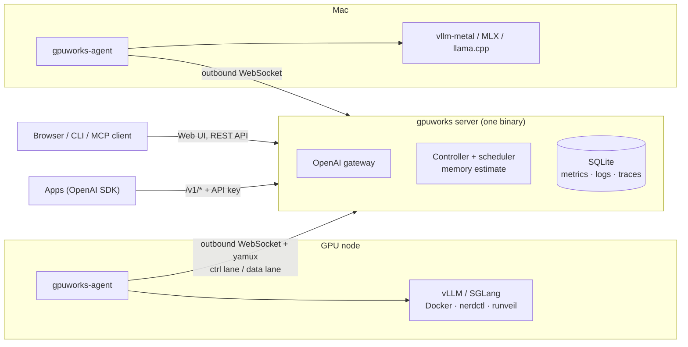

# Show HN: GPUWorks – A 40 MB GPU cluster manager for vLLM/SGLang, no K8s needed

> [!info] 一句话导读
> A ~45 MB MaaS platform: one cluster across public and private clouds, on any mix of accelerators.

> [!meta]- 语料信息（点开展开）
> 来源：HN Show HN（post）
> 原帖：<https://news.ycombinator.com/item?id=50367630>
> 指标：点赞=20 · 评论=0 · engagement_velocity=20
> 作者：wangweinoo1　|　发布：2026-11-04T16:09:54Z
> 项目链接：<https://github.com/flitai-io/gpuworks>
> 采集：2026-11-05T11:21:45+08:00　|　id：`820008d44aae48bd`

## 正文

# flitai-io/gpuworks

A ~45 MB MaaS platform: one cluster across public and private clouds, on any mix of accelerators.

- Stars: 64
- Forks: 24
- Watchers: 64
- Open issues: 2
- License: Apache License 2.0
- Default branch: master
- Created: 2026-10-22T22:17:35Z

## Languages

- C
- CSS
- Dockerfile
- Go
- HTML
- JavaScript
- Makefile
- Python
- SCSS
- Shell
- TypeScript

## Top Contributors

- MatheMatrix (613 contributions)
- AlanJager (343 contributions)
- Kid-G0629 (3 contributions)
- yahuuu (3 contributions)

---

## README

 A 40 MB MaaS platform: one cluster across public and private clouds, on any mix of accelerators.

 English | 简体中文

GPUWorks is an ultra-lightweight GPU management and Model-as-a-Service (MaaS) platform. The whole control plane, web
UI included, is a 40 MB download. Join your own GPU servers, rented cloud instances or containers, or a Mac with one
command, pick a model, and GPUWorks estimates the memory it needs, picks the GPUs, starts vLLM, SGLang or any engine
an inference template defines (Strata, ninfer, …), and serves it behind one OpenAI-compatible endpoint.
NVIDIA, AMD Instinct and Ryzen AI Max, Huawei Ascend, T-Head PPU, Hygon DCU and Apple Silicon run side by side in the
same cluster.

The pool of capacity is the core: bare-metal servers, public cloud instances and private cloud VMs today, with
Kubernetes clusters and Slurm partitions joining next. On top of it, GPUWorks serves models now and will run
fine-tuning and training jobs on the same accelerators.

## Highlights

- **Verified model × accelerator combinations deploy in one click.** The built-in catalog ships 1,235 launch specs
 for 392 models: image, engine, flags and pinned weight revisions for each GPU type. The combinations we have run
 on real NVIDIA, AMD, Ascend, PPU and Apple hardware come with launch settings that are known to work, so you pick a
 model and press deploy instead of hunting for flags. Qwen, DeepSeek, GLM, Kimi, MiniMax, Llama, Gemma, gpt-oss,
 plus embedding, rerank, speech, image and video models.
- **Heterogeneous accelerators, one scheduler.** NVIDIA, AMD, Ascend, PPU, Hygon and Apple Silicon nodes join the same
 cluster; the scheduler matches each deployment to hardware its launch spec supports.
- **Public and private cloud in one pool.** Sync instances from RunPod, CompShare, AutoDL, Vast.ai and Alibaba Cloud,
 or VMs from ZStack Cloud, install the agent in one click, and schedule them together with your own servers.
- **Ultra-lightweight.** The server and the agent are each one static binary (`CGO_ENABLED=0`); the server embeds the
 web UI (English / 中文) and the agents for every platform, and keeps its state in one SQLite file. The agent dials
 out over WebSocket, so nodes need no inbound ports (or the server dials in, for nodes that cannot reach out). In a
 drill on Alibaba Cloud, one server ran 1,003 rented GPU machines across 7 regions: over 500 replicas placed and
 running within 4 minutes, and 2,000 concurrent requests through the gateway with the server peaking at 9 CPU cores
 and 1.6 GB of memory.
- **Memory estimate and explained placement.** Before anything starts, you see how much GPU memory weights, KV
 cache and engine overhead need, which GPUs the scheduler picked and why the others were rejected.
- **Share a GPU between models.** dGPU puts a hard memory quota on each instance so several models fit on one card
 (NVIDIA via HAMi-core, Ascend via vCANN, PPU via HGGC, Hygon via hy-smi virtual devices). Sleep/wake lets vLLM models take turns
 on the same GPUs on NVIDIA, Ascend, PPU and Hygon.
- **Scale out.** Replicas across nodes, multi-node tensor/pipeline parallel, and prefill/decode disaggregation
 (vLLM + NIXL on NVIDIA, vLLM-Ascend + Mooncake on Ascend, SGLang or vLLM + Mooncake on PPU, within one host or over RDMA, and experimental vLLM + Mooncake on Hygon).
- **OpenAI-compatible gateway.** Chat, completions, embeddings, rerank, audio, images, video and realtime under
 `/v1`; `/v1/messages` and `/v1/responses` pass through. Least-request, prefix-affinity or failover routing, API
 keys, per-key token usage.
- **See what is going on.** GPU and engine metrics, searchable logs, per-request traces with a timeline (OTLP export),
 a web terminal into hosts and containers, and a built-in benchmark that sweeps concurrency and finds the SLA limit.
- **AI assistant and MCP.** Ask questions about the cluster in the UI, or connect Claude Code / any MCP client to the
 read-only MCP endpoint.
- **Air-gapped ready.** Import images and models from archives or an HTTP file server, and sync models between nodes.

## Quick start

**1. Install the server** on a Linux host (x86_64 or arm64) or an Apple Silicon Mac:

```bash
bash <(curl -fsSL https://dl.gpuworks.ai/get.sh)
```

The script picks the fastest download source (including mirrors in mainland China), verifies the checksum and runs
the installer, which sets up a service on port 8800 and prints the URL and the admin password. Add `--quiet` to
accept every default. To check each step yourself, follow the manual install.

**2. Add a GPU node.** Open the web UI, go to **Compute nodes → Add node**, and run the generated command on the GPU
host:

```bash
curl -fsSL http://<server>:8800/install.sh | sh -s -- --server http://<server>:8800 --token <node-token>
```

**3. Deploy a model.** Open **Deploy**, pick a model such as `Qwen/Qwen3-1.7B` and a recommended inference template,
review the configuration evaluation (memory estimate and placement), and deploy. Then create an inference token under
**API Tokens** and call the model by its public model name:

```bash
curl http://<server>:8800/v1/chat/completions \
  -H "Authorization: Bearer gw-..." -H "Content-Type: application/json" \
  -d '{"model": "qwen3-1.7b", "messages": [{"role": "user", "content": "Hello!"}]}'
```

The full walkthrough is in Getting started. For a Mac, see
Run your first local model on a Mac; for air-gapped sites, see
Offline deployment.

### Install with an AI coding agent

Paste this into Claude Code, Codex, Cursor or a similar agent that has shell access to your server:

```text
Install the GPUWorks control plane on this host and verify it.
1. Run `bash <(curl -fsSL https://dl.gpuworks.ai/get.sh) --quiet`. It downloads the latest build, verifies its
   checksum and installs a service on port 8800 (use sudo when asked). If I have no sudo or no systemd, append
   `--dir ~/gpuworks-server --no-systemd` instead.
2. Verify with `curl -fsS http://<listen-address>/healthz` (expect "status":"ok") and show me the install summary:
   URL, install directory, data directory and the initial admin password location.
3. Do not open firewall ports, change other services, or join GPU nodes. Tell me which address GPU nodes should
   use to reach the server; I will add nodes from the web UI.
```

## Supported hardware

| Accelerator | Whole-GPU deploy | dGPU (shared GPU) | Sleep/wake | Multi-node | PD disaggregation |
|---|---|---|---|---|---|
| **NVIDIA** (CUDA) | ✅ Docker, containerd or runveil (built-in rootless runtime) | ✅ memory quota at MiB granularity | ✅ vLLM | ✅ | ✅ vLLM + NIXL |
| **AMD** (ROCm: Instinct MI300 series, Ryzen AI Max) | ✅ Docker, containerd or runveil (built-in rootless runtime) | ✅ memory quota (libvrocm, user space) | ✅ vLLM | ✅ vLLM | ✅ vLLM + NIXL |
| **Huawei Ascend** (CANN) | ✅ Docker, containerd or runveil (built-in rootless runtime) | ✅ memory quota at MiB granularity | ✅ vLLM-Ascend | ✅ | ✅ vLLM-Ascend + Mooncake |
| **T-Head PPU** (HGGC) | ✅ Docker, containerd or runveil (built-in rootless runtime) | ✅ memory quota at MiB granularity | ✅ vLLM | ✅ | ✅ SGLang + Mooncake (same node or over RDMA), vLLM + Mooncake (RDMA) |
| **Hygon DCU** (DTK) | ✅ Docker, containerd or runveil (built-in rootless runtime) | ✅ memory quota at MiB granularity | ✅ vLLM | ✅ | 🧪 vLLM 0.21 + Mooncake |
| **Apple Silicon** (M1–M5, macOS 15+) | ✅ vllm-metal, MLX, llama.cpp as native processes | — | — | — | — |

✅ verified on real hardware · 🧪 experimental · — not supported or not validated. Sleep/wake beyond NVIDIA is
verified on Ascend 910C, PPU ZW810E, Hygon K100 and AMD MI300X; the tested versions and limits are in
choosing features.
GPUs are detected with the vendor CLIs (`nvidia-smi`, `npu-smi`, `ppu-smi`, `hy-smi`) or, for AMD, amdgpu sysfs and KFD, so there is no NVML or cgo
dependency. Per-combination status lives in the support matrix and the
Ascend matrix.

**Engines:** vLLM (incl. vLLM-Ascend and vLLM-Omni), SGLang, and on Mac vllm-metal, MLX-VLM, MLX-Audio and
llama.cpp. Built-in images are published as `gpuworks/gpuworks-runner` on Docker Hub, Quay and Huawei SWR
(image families); you can also bring your own image.

## Model catalog

The built-in catalog pins every model to fixed Hugging Face and ModelScope revisions and ships launch specs per
engine and accelerator. The deploy page recommends the specs that match the model and the target accelerator.

| Type | Examples |
|---|---|
| Chat / reasoning / code | Qwen3 / 3.5 / 3.6 / 3.8, Qwen3-Coder, DeepSeek R1 / V3.2 / V4, GLM-4.5 – 5.3, Kimi K2 – K3, MiniMax M2 – M3, Llama 3.x / 4, Gemma 3 / 4, gpt-oss, Mistral Large 3, ERNIE 4.5, Step-3.5, MiMo, Seed-OSS, Nemotron |
| Vision-language / OCR | Qwen3-VL, Qwen3-Omni, GLM-4.xV, Kimi-VL, DeepSeek-OCR, PaddleOCR-VL, GLM-OCR |
| Embedding / rerank | Qwen3-Embedding, Qwen3-Reranker, bge-m3, bge-reranker-v2-m3, Jina v5, EmbeddingGemma |
| Speech | Qwen3-ASR, Whisper large-v3, Qwen3-TTS, GLM-TTS, Voxtral, FishAudio S2-Pro |
| Image / video | Qwen-Image, GLM-Image, Stable Diffusion 3.5, Wan 2.1 / 2.2, LTX-2.5, Cosmos3 |

Catalog totals: 392 models from 77 organizations, 1,235 launch specs (745 NVIDIA, 216 PPU, 209 Ascend, 41 Hygon,
15 AMD, 9 Apple). Models outside the catalog can be registered from Hugging Face, ModelScope, a local directory, NFS or an
HTTP file server and deployed with your own arguments.

## Screenshots

| | |
|---|---|
| Overview **Overview** of a production cluster with NVIDIA, PPU, Ascend and Hygon GPUs | Scheduling **Scheduling analysis**: models taking turns on the same GPUs, card by card |
| Monitor **Monitoring** in production: latency, request shapes, concurrency and KV cache over 7 days | Usage **Usage analytics**: tokens by hour, API key and model |
| PD **PD disaggregation** on Ascend 910C: KV hand-off, latency breakdown, requests in flight | Health **GPU health checks**, diagnosed by the AI assistant |
| Network **Network test**: HCCS card-to-card reachability matrix | Benchmark **Benchmark** report: throughput, TTFT, latency |
| Templates **Model catalog** with launch specs per vendor and engine | Playground **Playground** against any deployment |

## Architecture



- The **server** is the control plane: REST API and web UI, the OpenAI-compatible gateway, a controller that
 reconciles desired state, the scheduler, and storage for metrics, logs and request traces.
- An **agent** runs on each GPU node. It probes the accelerators, runs engines through Docker, nerdctl, the built-in
 rootless runtime (runveil) or as host processes on macOS, and reports metrics and logs.
- Agents connect out to the server and multiplex everything over two lanes: `ctrl` for commands, metrics and
 terminals, `data` for inference traffic, logs and model/image transfer. Inference requests reach the engine
 through that tunnel, so nodes never expose ports.

More in Architecture and the ADRs.

## Documentation

| I want to… | Go to |
|---|---|
| Get it running | Getting started · Install the server · Connect nodes |
| Fit more on my GPUs | Choosing features · dGPU · Sleep/wake · Two models on one GPU |
| Serve bigger models or more traffic | Multi-node inference · PD disaggregation · Scale replicas |
| Measure and debug | Benchmark · Monitoring and logs · Trace a slow request · Troubleshooting |
| Integrate | OpenAI gateway · REST API · MCP · CLI |
| Run it in production | Production checklist · Offline · Upgrades · Security |

Everything else: documentation index.

Documentation Website

## Build from source

Requires Go 1.26 and Node.js.

```bash
make build      # web UI + server + agents into ./bin
make demo       # throwaway server + a GPU-less agent: onboarding, heartbeat, reconnect
make test       # static checks + Go unit tests + UI tests
make test-l2    # multi-process tests with real binaries and fake GPUs
```

See the developer docs and testing guide. How to file a
report, send a patch, or get a hardware combination into the support matrix is in
CONTRIBUTING.md; contributor conventions are in CLAUDE.md (Chinese) and
domain terms in CONTEXT.md. Security issues go to SECURITY.md — never a
public issue.

## Help us improve the product

Production installations send one anonymous usage report per day (hardware and engine mix, task counts, error
categories; no hostnames, model inputs or outputs, or any other sensitive information). Turn it off in
**Settings → General** or with `usage_report: false` in `server.yaml`. Every field is listed in
User Experience Improvement Program.

## License

GPUWorks is licensed under the Apache License 2.0. Bundled third-party components keep their own
licenses; see NOTICE.

# YashwanthKamireddi/Skykeep

## 关联链接

- https://dl.gpuworks.ai/get.sh

## 导航

- 项目页：[[10-项目/github.com_3c2eb939]]
- 渠道页：[[50-渠道/hn_show]]
- 赛道：`AI 工具/Agent`（见 [[浏览]] 的「按赛道」视图）
- 同渠道/同赛道批量浏览：[[浏览]]
